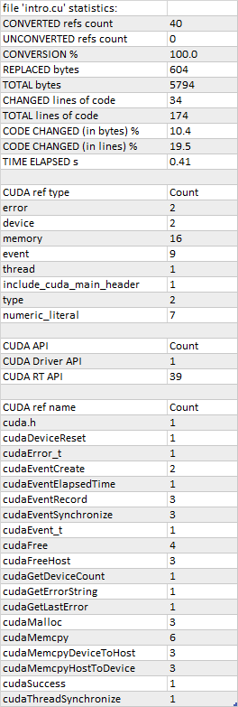

.. meta::
   :description: Tools to automatically translate CUDA source code into portable HIP C++
   :keywords: HIPIFY, ROCm, library, tool, CUDA, CUDA2HIP, hipify-clang, hipify-perl

.. _hipify-clang:

**************************************************************************
Using hipify-clang
**************************************************************************

``hipify-clang`` is a Clang-based tool for translating NVIDIA CUDA sources into HIP sources.

It translates CUDA source into an Abstract Syntax Tree (AST), which is traversed by transformation
matchers. After applying all the matchers, the output HIP source is produced.

**Advantages:**

- ``hipify-clang`` is a translator. It parses complex constructs successfully or reports an error.
- It supports Clang options such as
  `-I <https://clang.llvm.org/docs/ClangCommandLineReference.html#include-path-management>`__,
  `-D <https://clang.llvm.org/docs/ClangCommandLineReference.html#preprocessor-options>`__, and
  `--cuda-path <https://clang.llvm.org/docs/ClangCommandLineReference.html#cmdoption-clang-cuda-path>`__.
- The support for new CUDA versions is seamless, as the Clang front-end is statically linked into
  ``hipify-clang`` and does all the syntactical parsing of a CUDA source.
- It is very well supported as a compiler extension.

**Disadvantages:**

- You must ensure that the input CUDA code is correct, as incorrect code can't be translated to HIP.
- You must install CUDA, and in case of multiple installations specify the needed version using the ``--cuda-path`` option.
- You must provide all the ``includes`` and ``defines`` to successfully translate the code.

Release Dependencies
====================

``hipify-clang`` requires:

* `CUDA <https://developer.nvidia.com/cuda-downloads>`__ version
  `7.0 <https://developer.nvidia.com/cuda-toolkit-70>`__ or later (the latest supported version is
  `13.2.0 <https://developer.nvidia.com/cuda-13-2-0-download-archive>`__).

* `LLVM+Clang <http://releases.llvm.org>`__ version is determined at least partially by
  the CUDA version you are using, as shown in the table below. The recommended Clang release
  is the latest stable release `23.1.5 <https://github.com/llvm/llvm-project/releases/tag/llvmorg-23.1.5>`__,
  or at least version `4.0.0 <http://releases.llvm.org/download.html#4.0.0>`__.

.. list-table::
  :header-rows: 1

  * - Highest supported CUDA version
    - Supported LLVM release versions
    - Windows
    - Linux
  * - `13.2.0 <https://developer.nvidia.com/cuda-13-2-0-download-archive>`__ :sup:`1`
    - `23.1.0 <https://github.com/llvm/llvm-project/releases/tag/llvmorg-23.1.0>`__,
      `23.1.1 <https://github.com/llvm/llvm-project/releases/tag/llvmorg-23.1.1>`__,
      `23.1.2 <https://github.com/llvm/llvm-project/releases/tag/llvmorg-23.1.2>`__,
      `23.1.3 <https://github.com/llvm/llvm-project/releases/tag/llvmorg-23.1.3>`__,
      `23.1.4 <https://github.com/llvm/llvm-project/releases/tag/llvmorg-23.1.4>`__,
      `23.1.5 <https://github.com/llvm/llvm-project/releases/tag/llvmorg-23.1.5>`__ :sup:`1`,
      `24.0.0git <https://github.com/llvm/llvm-project>`__
    - ✅
    - ✅
  * - `12.9.1 <https://developer.nvidia.com/cuda-12-9-1-download-archive>`__
    - `21.1.0 <https://github.com/llvm/llvm-project/releases/tag/llvmorg-21.1.0>`__,
      `21.1.1 <https://github.com/llvm/llvm-project/releases/tag/llvmorg-21.1.1>`__,
      `21.1.2 <https://github.com/llvm/llvm-project/releases/tag/llvmorg-21.1.2>`__,
      `21.1.3 <https://github.com/llvm/llvm-project/releases/tag/llvmorg-21.1.3>`__,
      `21.1.4 <https://github.com/llvm/llvm-project/releases/tag/llvmorg-21.1.4>`__,
      `21.1.5 <https://github.com/llvm/llvm-project/releases/tag/llvmorg-21.1.5>`__,
      `21.1.6 <https://github.com/llvm/llvm-project/releases/tag/llvmorg-21.1.6>`__,
      `21.1.7 <https://github.com/llvm/llvm-project/releases/tag/llvmorg-21.1.7>`__,
      `21.1.8 <https://github.com/llvm/llvm-project/releases/tag/llvmorg-21.1.8>`__,
      `22.1.0 <https://github.com/llvm/llvm-project/releases/tag/llvmorg-22.1.0>`__,
      `22.1.1 <https://github.com/llvm/llvm-project/releases/tag/llvmorg-22.1.1>`__,
      `22.1.2 <https://github.com/llvm/llvm-project/releases/tag/llvmorg-22.1.2>`__,
      `22.1.3 <https://github.com/llvm/llvm-project/releases/tag/llvmorg-22.1.3>`__,
      `22.1.4 <https://github.com/llvm/llvm-project/releases/tag/llvmorg-22.1.4>`__,
      `22.1.5 <https://github.com/llvm/llvm-project/releases/tag/llvmorg-22.1.5>`__,
      `22.1.6 <https://github.com/llvm/llvm-project/releases/tag/llvmorg-22.1.6>`__,
      `22.1.7 <https://github.com/llvm/llvm-project/releases/tag/llvmorg-22.1.7>`__,
      `22.1.8 <https://github.com/llvm/llvm-project/releases/tag/llvmorg-22.1.8>`__
    - ✅
    - ✅
  * - `12.8.1 <https://developer.nvidia.com/cuda-12-8-1-download-archive>`__
    - `20.1.0 <https://github.com/llvm/llvm-project/releases/tag/llvmorg-20.1.0>`__,
      `20.1.1 <https://github.com/llvm/llvm-project/releases/tag/llvmorg-20.1.1>`__,
      `20.1.2 <https://github.com/llvm/llvm-project/releases/tag/llvmorg-20.1.2>`__,
      `20.1.3 <https://github.com/llvm/llvm-project/releases/tag/llvmorg-20.1.3>`__,
      `20.1.4 <https://github.com/llvm/llvm-project/releases/tag/llvmorg-20.1.4>`__,
      `20.1.5 <https://github.com/llvm/llvm-project/releases/tag/llvmorg-20.1.5>`__,
      `20.1.6 <https://github.com/llvm/llvm-project/releases/tag/llvmorg-20.1.6>`__,
      `20.1.7 <https://github.com/llvm/llvm-project/releases/tag/llvmorg-20.1.7>`__,
      `20.1.8 <https://github.com/llvm/llvm-project/releases/tag/llvmorg-20.1.8>`__
    - ✅
    - ✅
  * - `12.6.3 <https://developer.nvidia.com/cuda-12-6-3-download-archive>`__
    - `19.1.0 <https://github.com/llvm/llvm-project/releases/tag/llvmorg-19.1.0>`__,
      `19.1.1 <https://github.com/llvm/llvm-project/releases/tag/llvmorg-19.1.1>`__,
      `19.1.2 <https://github.com/llvm/llvm-project/releases/tag/llvmorg-19.1.2>`__,
      `19.1.3 <https://github.com/llvm/llvm-project/releases/tag/llvmorg-19.1.3>`__,
      `19.1.4 <https://github.com/llvm/llvm-project/releases/tag/llvmorg-19.1.4>`__,
      `19.1.5 <https://github.com/llvm/llvm-project/releases/tag/llvmorg-19.1.5>`__,
      `19.1.6 <https://github.com/llvm/llvm-project/releases/tag/llvmorg-19.1.6>`__,
      `19.1.7 <https://github.com/llvm/llvm-project/releases/tag/llvmorg-19.1.7>`__
    - ✅
    - ✅
  * - `12.3.2 <https://developer.nvidia.com/cuda-12-3-2-download-archive>`__
    - `17.0.1 <https://github.com/llvm/llvm-project/releases/tag/llvmorg-17.0.1>`__,
      `17.0.2 <https://github.com/llvm/llvm-project/releases/tag/llvmorg-17.0.2>`__,
      `17.0.3 <https://github.com/llvm/llvm-project/releases/tag/llvmorg-17.0.3>`__,
      `17.0.4 <https://github.com/llvm/llvm-project/releases/tag/llvmorg-17.0.4>`__,
      `17.0.5 <https://github.com/llvm/llvm-project/releases/tag/llvmorg-17.0.5>`__,
      `17.0.6 <https://github.com/llvm/llvm-project/releases/tag/llvmorg-17.0.6>`__,
      `18.1.0 <https://github.com/llvm/llvm-project/releases/tag/llvmorg-18.1.0>`__,
      `18.1.1 <https://github.com/llvm/llvm-project/releases/tag/llvmorg-18.1.1>`__,
      `18.1.2 <https://github.com/llvm/llvm-project/releases/tag/llvmorg-18.1.2>`__,
      `18.1.3 <https://github.com/llvm/llvm-project/releases/tag/llvmorg-18.1.3>`__,
      `18.1.4 <https://github.com/llvm/llvm-project/releases/tag/llvmorg-18.1.4>`__,
      `18.1.5 <https://github.com/llvm/llvm-project/releases/tag/llvmorg-18.1.5>`__,
      `18.1.6 <https://github.com/llvm/llvm-project/releases/tag/llvmorg-18.1.6>`__,
      `18.1.7 <https://github.com/llvm/llvm-project/releases/tag/llvmorg-18.1.7>`__,
      `18.1.8 <https://github.com/llvm/llvm-project/releases/tag/llvmorg-18.1.8>`__
    - ✅
    - ✅
  * - `12.2.2 <https://developer.nvidia.com/cuda-12-2-2-download-archive>`__
    - `16.0.0 <https://github.com/llvm/llvm-project/releases/tag/llvmorg-16.0.0>`__,
      `16.0.1 <https://github.com/llvm/llvm-project/releases/tag/llvmorg-16.0.1>`__,
      `16.0.2 <https://github.com/llvm/llvm-project/releases/tag/llvmorg-16.0.2>`__,
      `16.0.3 <https://github.com/llvm/llvm-project/releases/tag/llvmorg-16.0.3>`__,
      `16.0.4 <https://github.com/llvm/llvm-project/releases/tag/llvmorg-16.0.4>`__,
      `16.0.5 <https://github.com/llvm/llvm-project/releases/tag/llvmorg-16.0.5>`__,
      `16.0.6 <https://github.com/llvm/llvm-project/releases/tag/llvmorg-16.0.6>`__
    - ✅
    - ✅
  * - `11.8.0 <https://developer.nvidia.com/cuda-11-8-0-download-archive>`__
    - `14.0.5 <https://github.com/llvm/llvm-project/releases/tag/llvmorg-14.0.5>`__,
      `14.0.6 <https://github.com/llvm/llvm-project/releases/tag/llvmorg-14.0.6>`__,
      `15.0.0 <https://github.com/llvm/llvm-project/releases/tag/llvmorg-15.0.0>`__,
      `15.0.1 <https://github.com/llvm/llvm-project/releases/tag/llvmorg-15.0.1>`__,
      `15.0.2 <https://github.com/llvm/llvm-project/releases/tag/llvmorg-15.0.2>`__,
      `15.0.3 <https://github.com/llvm/llvm-project/releases/tag/llvmorg-15.0.3>`__,
      `15.0.4 <https://github.com/llvm/llvm-project/releases/tag/llvmorg-15.0.4>`__,
      `15.0.5 <https://github.com/llvm/llvm-project/releases/tag/llvmorg-15.0.5>`__,
      `15.0.6 <https://github.com/llvm/llvm-project/releases/tag/llvmorg-15.0.6>`__,
      `15.0.7 <https://github.com/llvm/llvm-project/releases/tag/llvmorg-15.0.7>`__
    - ✅
    - ✅
  * - `11.7.1 <https://developer.nvidia.com/cuda-11-7-1-download-archive>`__
    - `14.0.0 <https://github.com/llvm/llvm-project/releases/tag/llvmorg-14.0.0>`__,
      `14.0.1 <https://github.com/llvm/llvm-project/releases/tag/llvmorg-14.0.1>`__,
      `14.0.2 <https://github.com/llvm/llvm-project/releases/tag/llvmorg-14.0.2>`__,
      `14.0.3 <https://github.com/llvm/llvm-project/releases/tag/llvmorg-14.0.3>`__,
      `14.0.4 <https://github.com/llvm/llvm-project/releases/tag/llvmorg-14.0.4>`__
    - Works only with patch due to Clang bug `54609 <https://github.com/llvm/llvm-project/issues/54609>`__
      |patch for 14.0.0| :sup:`2`
      |patch for 14.0.1| :sup:`2`
      |patch for 14.0.2| :sup:`2`
      |patch for 14.0.3| :sup:`2`
      |patch for 14.0.4| :sup:`2`
    - ✅
  * - `11.5.1 <https://developer.nvidia.com/cuda-11-5-1-download-archive>`__
    - `12.0.0 <https://github.com/llvm/llvm-project/releases/tag/llvmorg-12.0.0>`__,
      `12.0.1 <https://github.com/llvm/llvm-project/releases/tag/llvmorg-12.0.1>`__,
      `13.0.0 <https://github.com/llvm/llvm-project/releases/tag/llvmorg-13.0.0>`__,
      `13.0.1 <https://github.com/llvm/llvm-project/releases/tag/llvmorg-13.0.1>`__
    - ✅
    - ✅
  * - `11.2.2 <https://developer.nvidia.com/cuda-11-2-2-download-archive>`__
    - `11.0.1 <https://github.com/llvm/llvm-project/releases/tag/llvmorg-11.0.1>`__,
      `11.1.0 <https://github.com/llvm/llvm-project/releases/tag/llvmorg-11.1.0>`__
    - ✅
    - ✅
  * - `11.0.1 <https://developer.nvidia.com/cuda-11-0-1-download-archive>`__,
      `11.1.0 <https://developer.nvidia.com/cuda-11.1.0-download-archive>`__,
      `11.1.1 <https://developer.nvidia.com/cuda-11.1.1-download-archive>`__
    - `11.0.0 <https://github.com/llvm/llvm-project/releases/tag/llvmorg-11.0.0>`__
    - Works only with patch due to Clang bug `47332 <https://bugs.llvm.org/show_bug.cgi?id=47332>`__
      |patch for 11.0.0| :sup:`3`
    - Works only with patch due to Clang bug `47332 <https://bugs.llvm.org/show_bug.cgi?id=47332>`__
      |patch for 11.0.0| :sup:`3`
  * - `11.0.0 <https://developer.nvidia.com/cuda-11.0-download-archive>`__
    - `11.0.0 <https://github.com/llvm/llvm-project/releases/tag/llvmorg-11.0.0>`__
    - ✅
    - ✅
  * - `11.0.1 <https://developer.nvidia.com/cuda-11-0-1-download-archive>`__,
      `11.1.0 <https://developer.nvidia.com/cuda-11.1.0-download-archive>`__,
      `11.1.1 <https://developer.nvidia.com/cuda-11.1.1-download-archive>`__
    - `10.0.0 <https://github.com/llvm/llvm-project/releases/tag/llvmorg-10.0.0>`__,
      `10.0.1 <https://github.com/llvm/llvm-project/releases/tag/llvmorg-10.0.1>`__
    - Works only with patch due to Clang bug `47332 <https://bugs.llvm.org/show_bug.cgi?id=47332>`__
      |patch for 10.0.0| :sup:`3`
      |patch for 10.0.1| :sup:`3`
    - Works only with patch due to Clang bug `47332 <https://bugs.llvm.org/show_bug.cgi?id=47332>`__
      |patch for 10.0.0| :sup:`3`
      |patch for 10.0.1| :sup:`3`
  * - `11.0.0 <https://developer.nvidia.com/cuda-11.0-download-archive>`__
    - `10.0.0 <https://github.com/llvm/llvm-project/releases/tag/llvmorg-10.0.0>`__,
      `10.0.1 <https://github.com/llvm/llvm-project/releases/tag/llvmorg-10.0.1>`__
    - ✅
    - ✅
  * - `10.1 <https://developer.nvidia.com/cuda-10.1-download-archive-update2>`__
    - `9.0.0 <http://releases.llvm.org/download.html#9.0.0>`__,
      `9.0.1 <http://releases.llvm.org/download.html#9.0.1>`__
    - ✅
    - ✅
  * - `10.0 <https://developer.nvidia.com/cuda-10.0-download-archive>`__
    - `8.0.0 <http://releases.llvm.org/download.html#8.0.0>`__,
      `8.0.1 <http://releases.llvm.org/download.html#8.0.1>`__
    - Works only with patch due to Clang bug `38811 <https://bugs.llvm.org/show_bug.cgi?id=38811>`__
      |patch for 8.0.0| :sup:`2`
      |patch for 8.0.1| :sup:`2`
    - ✅
  * - `9.2 <https://developer.nvidia.com/cuda-92-download-archive>`__
    - `7.0.0 <http://releases.llvm.org/download.html#7.0.0>`__,
      `7.0.1 <http://releases.llvm.org/download.html#7.0.1>`__,
      `7.1.0 <http://releases.llvm.org/download.html#7.1.0>`__
    - Works only with patch due to Clang bug `38811 <https://bugs.llvm.org/show_bug.cgi?id=38811>`__
      |patch for 7.0.0| :sup:`2`
      |patch for 7.0.1| :sup:`2`
      |patch for 7.1.0| :sup:`2`
    - ❌ due to Clang bug `36384 <https://bugs.llvm.org/show_bug.cgi?id=36384>`__
  * - `9.0 <https://developer.nvidia.com/cuda-90-download-archive>`__
    - `6.0.0 <http://releases.llvm.org/download.html#6.0.0>`__,
      `6.0.1 <http://releases.llvm.org/download.html#6.0.1>`__
    - ✅
    - ✅
  * - `8.0 <https://developer.nvidia.com/cuda-80-ga2-download-archive>`__
    - `4.0.0 <http://releases.llvm.org/download.html#4.0.0>`__,
      `4.0.1 <http://releases.llvm.org/download.html#4.0.1>`__,
      `5.0.0 <http://releases.llvm.org/download.html#5.0.0>`__,
      `5.0.1 <http://releases.llvm.org/download.html#5.0.1>`__,
      `5.0.2 <http://releases.llvm.org/download.html#5.0.2>`__
    - ✅
    - ✅
  * - `7.5 <https://developer.nvidia.com/cuda-75-downloads-archive>`__
    - `3.8.0 <http://releases.llvm.org/download.html#3.8.0>`__ :sup:`4`,
      `3.8.1 <http://releases.llvm.org/download.html#3.8.1>`__ :sup:`4`,
      `3.9.0 <http://releases.llvm.org/download.html#3.9.0>`__ :sup:`4`,
      `3.9.1 <http://releases.llvm.org/download.html#3.9.1>`__ :sup:`4`
    - ✅
    - ✅

.. |patch for 7.0.0| replace::
  :download:`patch for 7.0.0 <../data/patches/patch_for_clang_7.0.0_bug_38811.zip>`
.. |patch for 7.0.1| replace::
  :download:`patch for 7.0.1 <../data/patches/patch_for_clang_7.0.1_bug_38811.zip>`
.. |patch for 7.1.0| replace::
  :download:`patch for 7.1.0 <../data/patches/patch_for_clang_7.1.0_bug_38811.zip>`
.. |patch for 8.0.0| replace::
  :download:`patch for 8.0.0 <../data/patches/patch_for_clang_8.0.0_bug_38811.zip>`
.. |patch for 8.0.1| replace::
  :download:`patch for 8.0.1 <../data/patches/patch_for_clang_8.0.1_bug_38811.zip>`
.. |patch for 10.0.0| replace::
  :download:`patch for 10.0.0 <../data/patches/patch_for_clang_10.0.0_bug_47332.zip>`
.. |patch for 10.0.1| replace::
  :download:`patch for 10.0.1 <../data/patches/patch_for_clang_10.0.1_bug_47332.zip>`
.. |patch for 11.0.0| replace::
  :download:`patch for 11.0.0 <../data/patches/patch_for_clang_11.0.0_bug_47332.zip>`
.. |patch for 14.0.0| replace::
  :download:`patch for 14.0.0 <../data/patches/patch_for_clang_14.0.0_bug_54609.zip>`
.. |patch for 14.0.1| replace::
  :download:`patch for 14.0.1 <../data/patches/patch_for_clang_14.0.1_bug_54609.zip>`
.. |patch for 14.0.2| replace::
  :download:`patch for 14.0.2 <../data/patches/patch_for_clang_14.0.2_bug_54609.zip>`
.. |patch for 14.0.3| replace::
  :download:`patch for 14.0.3 <../data/patches/patch_for_clang_14.0.3_bug_54609.zip>`
.. |patch for 14.0.4| replace::
  :download:`patch for 14.0.4 <../data/patches/patch_for_clang_14.0.4_bug_54609.zip>`

:sup:`1` Represents the latest supported and recommended configuration.

:sup:`2` Download the patch and unpack it into your ``LLVM distribution directory``. This overwrites a few header files. You don't need to rebuild ``LLVM``.

:sup:`3` Download the patch and unpack it into your ``LLVM source directory``. This overwrites the ``Cuda.cpp`` file. You need to rebuild ``LLVM``.

:sup:`4` ``LLVM 3.x`` is no longer supported (but might still work).

In most cases, you can get a suitable version of ``LLVM+Clang`` with your package manager. However, you can also
`download a release archive <http://releases.llvm.org/>`__ and build or install it. In case of multiple versions of ``LLVM`` installed, set
`CMAKE_PREFIX_PATH <https://cmake.org/cmake/help/latest/variable/CMAKE_PREFIX_PATH.html>`__ so that
``CMake`` can find the desired version of ``LLVM``. For example, ``-DCMAKE_PREFIX_PATH=D:\LLVM\23.1.5\dist``.

Usage
=====

.. note::
  For additional details on the following ``hipify-clang`` command options, see :ref:`hipify-clang-cmd`.

To process a file, ``hipify-clang`` needs access to the same headers that are required to compile it
with ``Clang``:

.. code:: shell

  ./hipify-clang square.cu --cuda-path=/usr/local/cuda-13.2 -I /usr/local/cuda-13.2/samples/common/inc

``hipify-clang`` arguments are supplied first, followed by a separator ``--`` and the arguments to be
passed to Clang for compiling the input file:

.. code:: shell

  ./hipify-clang cpp17.cu --cuda-path=/usr/local/cuda-13.2 -- -std=c++17

``hipify-clang`` also supports the hipification of multiple files that can be specified in a single
command with absolute or relative paths:

.. code:: shell

  ./hipify-clang cpp17.cu ../../square.cu /home/user/cuda/intro.cu --cuda-path=/usr/local/cuda-13.2 -- -std=c++17

To use a specific version of LLVM during hipification, specify the ``hipify-clang`` option
``--clang-resource-directory=`` to point to the Clang resource directory, which is the
parent directory for the ``include`` folder that contains ``__clang_cuda_runtime_wrapper.h`` and other
header files used during the hipification process:

.. code:: shell

  ./hipify-clang square.cu --cuda-path=/usr/local/cuda-13.2 --clang-resource-directory=/usr/llvm/23.1.5/dist/lib/clang/23

For more information, refer to the `Clang manual for compiling CUDA <https://llvm.org/docs/CompileCudaWithLLVM.html#compiling-cuda-code>`__.

.. _hipify-json:

Using JSON compilation database
===============================

For some hipification automation (starting from Clang 8.0.0), you can provide a
`Compilation Database in JSON format <https://clang.llvm.org/docs/JSONCompilationDatabase.html>`__
in the ``compile_commands.json`` file:

.. code:: text

  -p <folder containing compile_commands.json>
  - or -
  -p=<folder containing compile_commands.json>

You can provide the compilation database in the ``compile_commands.json`` file or generate it using
``-DCMAKE_EXPORT_COMPILE_COMMANDS=ON`` on the CMake command line. You can specify multiple source files as well.

To provide Clang options, use the ``compile_commands.json`` file, whereas to provide ``hipify-clang`` options, use the ``hipify-clang`` command line.

.. note::

  Do not use the ``--`` option separator on the command line with ``-p`` or inside ``compile_commands.json``.
  On the command line, ``--`` overrides ``-p`` and causes ``compile_commands.json`` to be ignored; inside
  ``compile_commands.json``, ``--`` causes the Clang driver to treat subsequent arguments as input files rather
  than compiler options, while any ``hipify-clang`` options in ``"command"`` fail as unknown Clang arguments.

Here's an
`example <https://github.com/ROCm/HIPIFY/blob/amd-staging/tests/unit_tests/compilation_database/compilation_database_before_13000/compile_commands.json.in>`__
demonstrating the ``compile_commands.json`` usage:

.. code:: json

  [
    {
      "directory": "<test dir>",
      "command": "hipify-clang \"<CUDA dir>\" -I./include -v",
      "file": "cd_intro.cu"
    }
  ]

.. _hipify-stats:

Hipification statistics
=======================

The options ``--print-stats`` and ``--print-stats-csv`` provide an overview of what is hipified and what is not, as well as the hipification statistics. Use the ``--print-stats`` option to return the statistics as text to the terminal, or the ``--print-stats-csv`` option to create a CSV file to open in a spreadsheet.

.. note::
  When multiple source files are specified on the command line, the statistics are provided per file and in total.

Print statistics
----------------

.. code:: shell

  hipify-clang intro.cu --cuda-path="C:/Program Files/NVIDIA GPU Computing Toolkit/CUDA/v13.2" --print-stats

.. code:: text

  [HIPIFY] info: file 'intro.cu' statistics:
    CONVERTED refs count: 40
    UNCONVERTED refs count: 0
    CONVERSION %: 100.0
    REPLACED bytes: 604
    TOTAL bytes: 5794
    CHANGED lines of code: 34
    TOTAL lines of code: 174
    CODE CHANGED (in bytes) %: 10.4
    CODE CHANGED (in lines) %: 19.5
    TIME ELAPSED s: 0.41
  [HIPIFY] info: CONVERTED refs by type:
    error: 2
    device: 2
    memory: 16
    event: 9
    thread: 1
    include_cuda_main_header: 1
    type: 2
    numeric_literal: 7
  [HIPIFY] info: CONVERTED refs by API:
    CUDA Driver API: 1
    CUDA RT API: 39
  [HIPIFY] info: CONVERTED refs by names:
    cuda.h: 1
    cudaDeviceReset: 1
    cudaError_t: 1
    cudaEventCreate: 2
    cudaEventElapsedTime: 1
    cudaEventRecord: 3
    cudaEventSynchronize: 3
    cudaEvent_t: 1
    cudaFree: 4
    cudaFreeHost: 3
    cudaGetDeviceCount: 1
    cudaGetErrorString: 1
    cudaGetLastError: 1
    cudaMalloc: 3
    cudaMemcpy: 6
    cudaMemcpyDeviceToHost: 3
    cudaMemcpyHostToDevice: 3
    cudaSuccess: 1
    cudaThreadSynchronize: 1

Print CSV statistics
--------------------

.. code:: shell

  hipify-clang intro.cu --cuda-path="C:/Program Files/NVIDIA GPU Computing Toolkit/CUDA/v13.2" --print-stats-csv

This generates an ``intro.cu.csv`` file with statistics:

